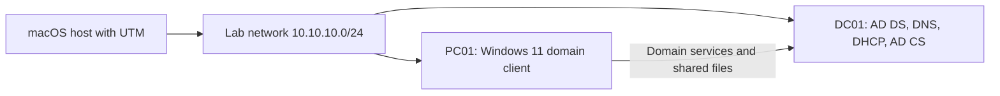

# Windows Enterprise IT Lab Portfolio

A hands-on Windows Server 2025 and Windows 11 lab demonstrating domain administration, client networking, remote troubleshooting, shared storage, security-event inspection, and certificate services.

The environment uses UTM on macOS, a domain controller named **DC01**, a client named **PC01**, and the **lab.test** domain. Evidence was captured on September 13 and October 11, 2026.

## Start here

For a quick review, open the domain-join result in module 1, the successful remote policy refresh in module 2, and the mapped-drive result in module 4. Each module includes an objective, implementation summary, visible results, limitations, and a numbered screenshot walkthrough.

| Module | Skills demonstrated | Visible result |
| --- | --- | --- |
| [01 Active Directory and virtual network foundation](labs/01-active-directory-foundation/README.md) | Domain discovery, DNS diagnosis, virtual networking | PC01 domain-join confirmation |
| [02 Group Policy and remote administration](labs/02-group-policy-and-remoting/README.md) | Account-policy configuration and remote troubleshooting | Remote computer and user policy refresh succeeds |
| [03 DHCP and client networking](labs/03-dhcp-and-client-networking/README.md) | DHCP configuration and client address validation | PC01 receives 10.10.10.100 and reaches lab.test |
| [04 File sharing and drive mapping](labs/04-file-sharing-and-drive-mapping/README.md) | SMB, NTFS, and Group Policy drive mapping | Company Data drive appears on PC01 |
| [05 Security event review](labs/05-security-event-review/README.md) | Windows authentication-event inspection | Successful logon Event ID 4624 displayed |
| [06 Certificate services and workstation enrollment](labs/06-certificate-services/README.md) | AD CS and workstation certificate inspection | Certificate for PC01.lab.test displayed |

## Environment

| Component | Lab role | Address or identifier |
| --- | --- | --- |
| macOS and UTM | Virtual-machine host | Host Only / Network 0 shown during setup |
| Windows Server 2025 | DC01; AD DS, DNS, DHCP, later AD CS | 10.10.10.10 |
| Windows 11 | PC01; domain client | Initially 10.10.10.20; later DHCP 10.10.10.100 |
| Active Directory | Lab domain | lab.test |
| Certificate authority | Lab enterprise root CA | lab-DC01-CA |

## How to read the evidence

This is one evolving lab presented as six modules. Screenshot filenames describe what is visible and use a two-digit sequence within each module. Failed commands are retained where they explain the troubleshooting path. Claims distinguish screenshot evidence from details reported in the original lab notes. This is a learning environment, not a claim of production deployment or a prescribed security baseline.

The original Word reports remain in the local source folder. They informed these summaries but are not included in this public portfolio. The portfolio contains 44 selected screenshots; unrelated, credential-bearing, blank, and obstructed captures are excluded.

## Next validation work

- Capture effective Group Policy and account-policy results on PC01.
- Test share permissions with allowed and denied standard-user accounts.
- Capture certificate trust, enrollment settings, and renewal behavior.
- Complete and document LDAPS validation and Windows LAPS, which remain planned work.

See [portfolio maintenance](docs/MAINTAINING.md) for naming conventions and adding future labs.
