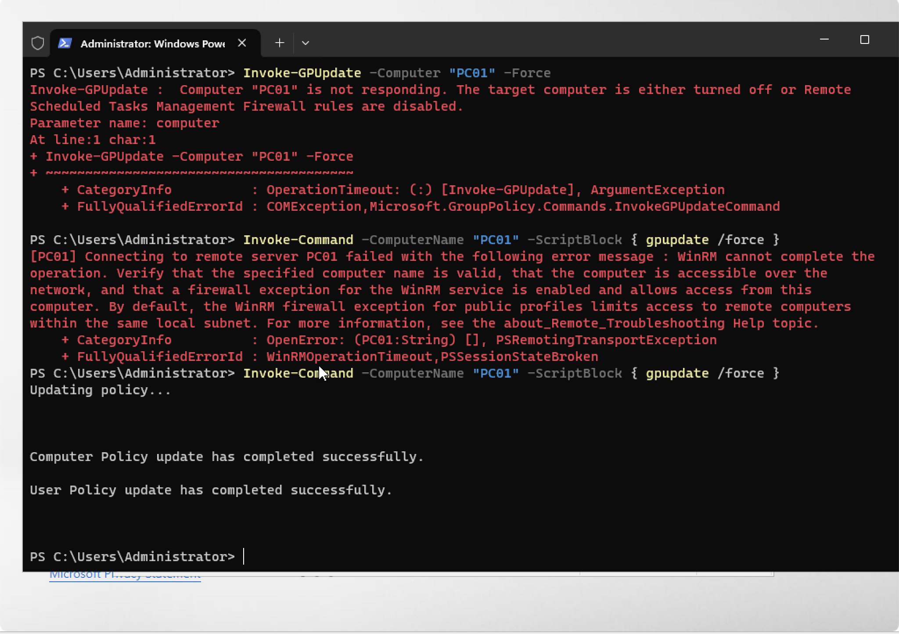
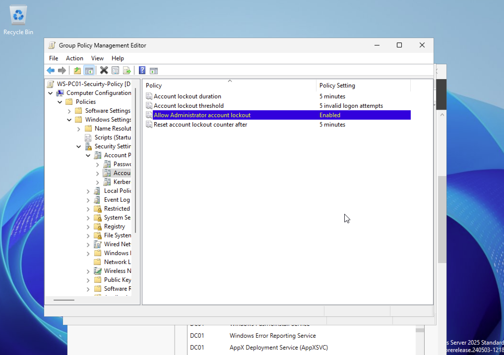
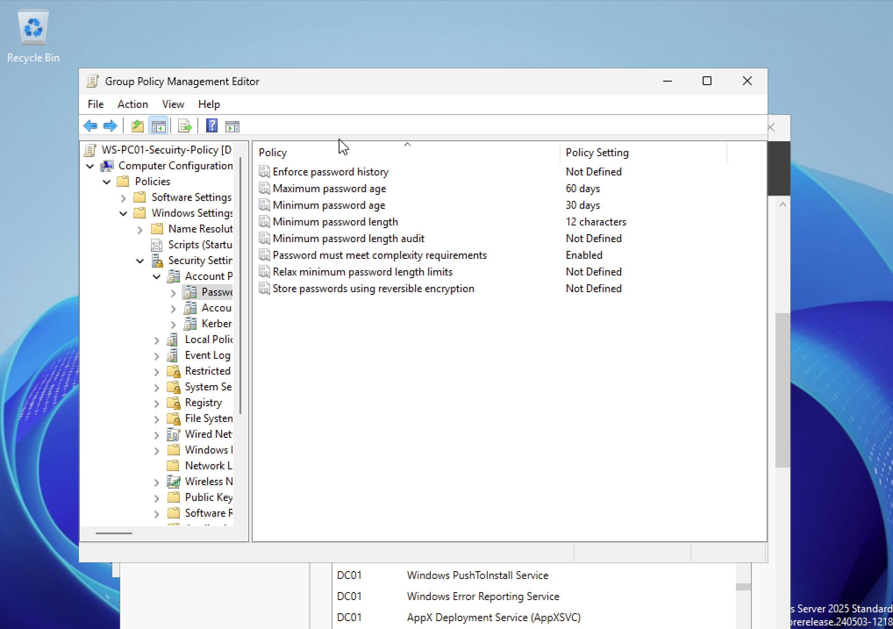
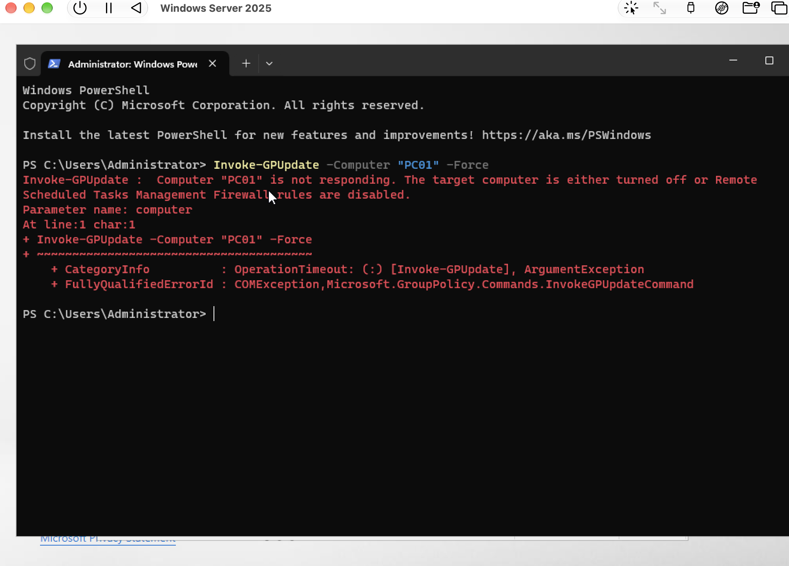
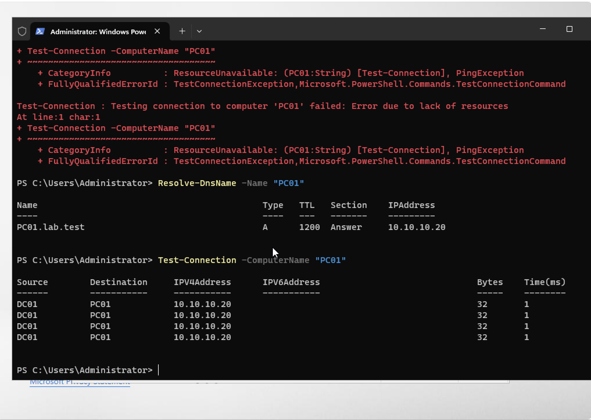
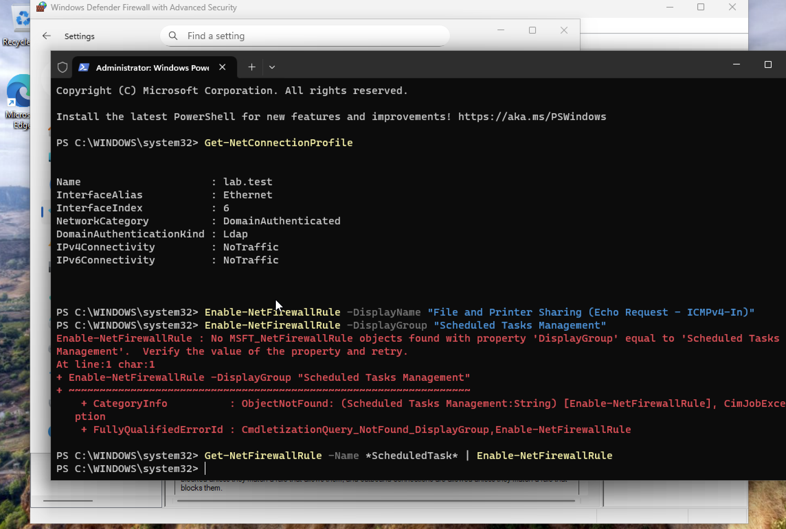
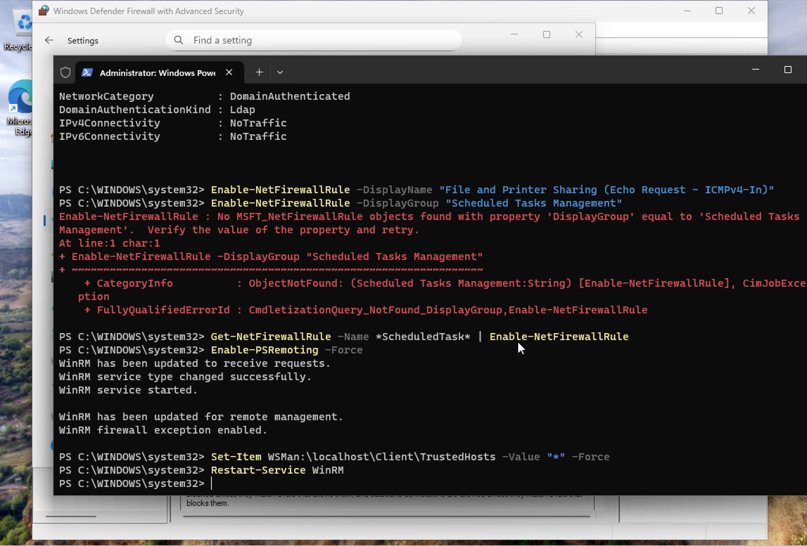

# Group Policy and remote administration

[Back to portfolio](../../README.md)

## Objective

Configure workstation account policies and troubleshoot remote policy refresh.

**Technologies:** Group Policy Management, Windows Firewall, PowerShell remoting, DNS

## Implementation and results

The policy editor shows an account lockout threshold of five invalid attempts, five-minute lockout and reset intervals, and Administrator lockout enabled. The password-policy view shows a 12-character minimum, complexity enabled, a 60-day maximum age, and a 30-day minimum age.

**Troubleshooting:** Remote policy refresh fails first. The record then shows name resolution and ping checks, inspection of the DomainAuthenticated network profile, a firewall-rule lookup error, and enabling PowerShell remoting. A later `Invoke-Command` call runs `gpupdate /force` successfully for computer and user policy.

**Evidence limits:** Editor settings and a successful refresh do not independently prove the effective settings or scope on PC01. Capture a resultant-policy report and effective account-policy output before claiming enforcement. The source write-up reports an Endpoints OU link, but that link is not pictured here.

**Lab configuration note:** One troubleshooting screenshot sets TrustedHosts to `*`. This records the lab experiment, not a production configuration recommendation.

## Result at a glance

## Evidence walkthrough

Screenshots are numbered chronologically within this module. Capture times come from original filenames; guest operating-system clocks may differ. Error screens are retained to show the troubleshooting sequence.

| Step | Evidence | Capture time |
| --- | --- | --- |
| 01 | [Configure account lockout policy](screenshots/01-configure-account-lockout-policy.png) | 2026-10-11 at 14.51.50 |
| 02 | [Configure password policy](screenshots/02-configure-password-policy.png) | 2026-10-11 at 14.52.00 |
| 03 | [Remote gpupdate fails](screenshots/03-remote-gpupdate-fails.png) | 2026-10-11 at 14.58.33 |
| 04 | [Resolve pc01 and verify connectivity](screenshots/04-resolve-pc01-and-verify-connectivity.png) | 2026-10-11 at 15.05.19 |
| 05 | [Inspect domain profile and firewall rule error](screenshots/05-inspect-domain-profile-and-firewall-rule-error.png) | 2026-10-11 at 15.05.27 |
| 06 | [Enable powershell remoting](screenshots/06-enable-powershell-remoting.png) | 2026-10-11 at 15.08.03 |
| 07 | [Remote policy refresh succeeds](screenshots/07-remote-policy-refresh-succeeds.png) | 2026-10-11 at 15.09.26 |

Open the full screenshot walkthrough

### 01 Configure account lockout policy

### 02 Configure password policy

### 03 Remote gpupdate fails

### 04 Resolve pc01 and verify connectivity

### 05 Inspect domain profile and firewall rule error

### 06 Enable powershell remoting

### 07 Remote policy refresh succeeds

