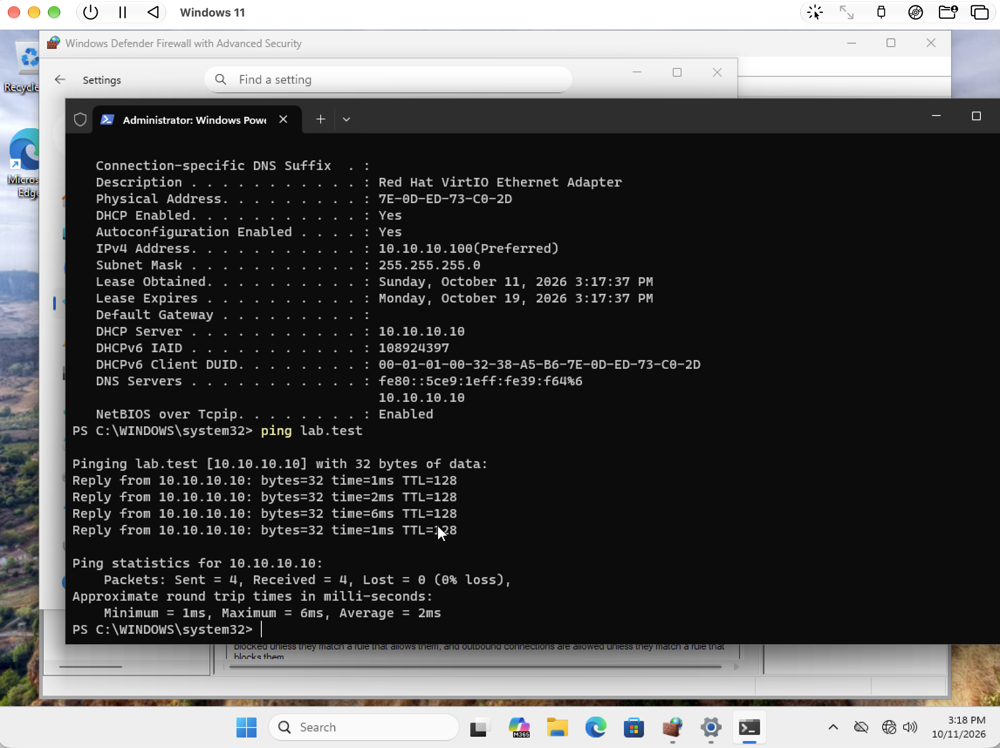
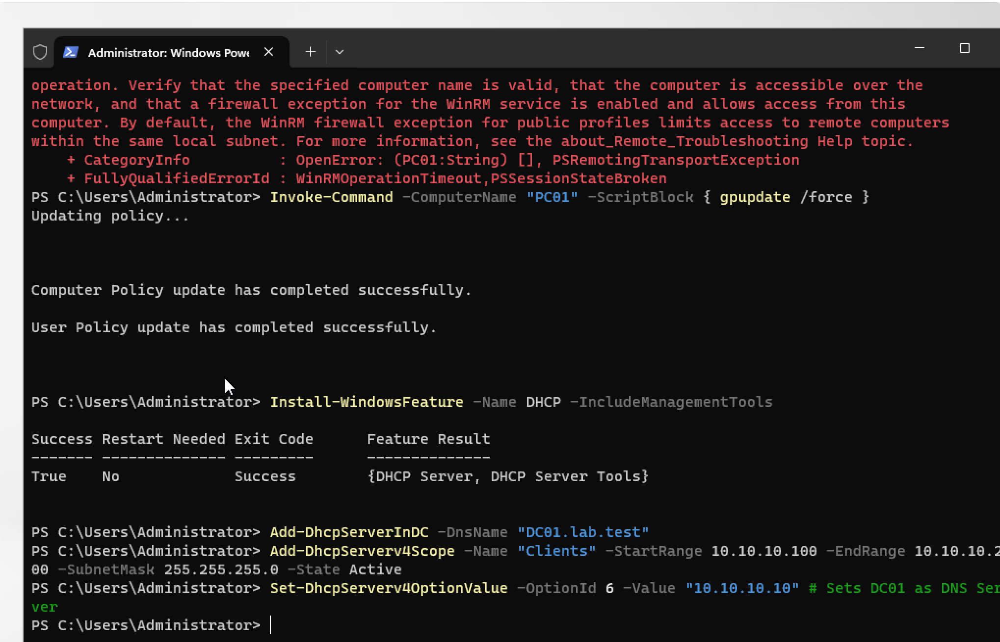
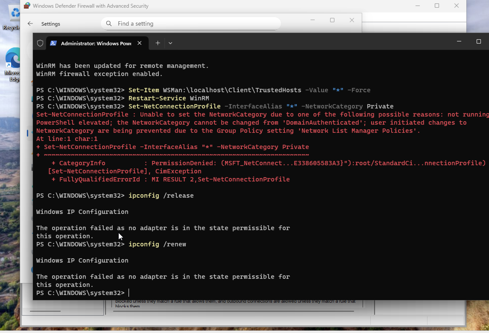
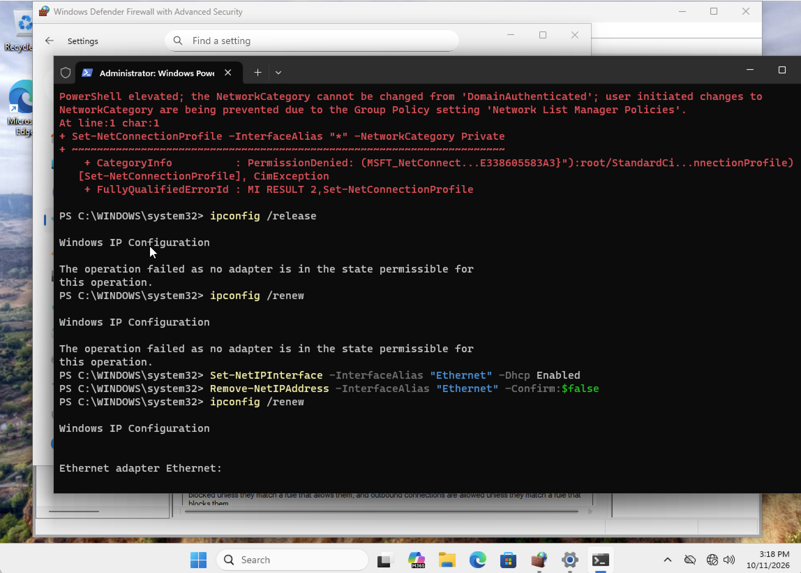
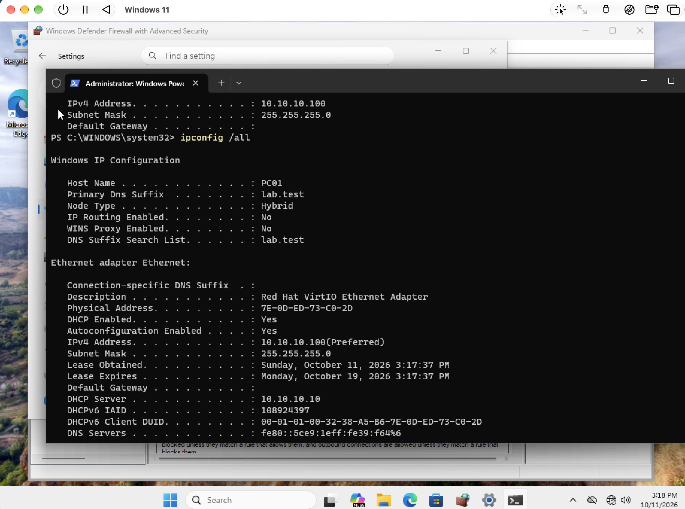

# DHCP and client networking

[Back to portfolio](../../README.md)

## Objective

Provision client addressing from DC01 and validate connectivity after the transition from static addressing.

**Technologies:** Windows DHCP Server, PowerShell, Windows client networking

## Implementation and results

The server screenshot shows DHCP role installation and scope configuration. The write-up records a Clients scope of `10.10.10.100–10.10.10.200` and DNS option 6 pointing to `10.10.10.10`.

**Troubleshooting:** Release and renew initially fail while the client is statically configured. The adapter is then switched to DHCP. The client subsequently shows DHCP enabled, an address of `10.10.10.100`, and DHCP server `10.10.10.10`. A ping to `lab.test` resolves to DC01 and returns replies.

**Evidence limits:** The screenshot validates one client lease and domain connectivity. It does not demonstrate internet routing, scope exhaustion handling, or DHCP resilience. The failed attempt to change the DomainAuthenticated network category is retained as troubleshooting evidence.

## Result at a glance

## Evidence walkthrough

Screenshots are numbered chronologically within this module. Capture times come from original filenames; guest operating-system clocks may differ. Error screens are retained to show the troubleshooting sequence.

| Step | Evidence | Capture time |
| --- | --- | --- |
| 01 | [Install dhcp role and configure scope](screenshots/01-install-dhcp-role-and-configure-scope.png) | 2026-10-11 at 15.14.06 |
| 02 | [Static client release renew fails](screenshots/02-static-client-release-renew-fails.png) | 2026-10-11 at 15.16.53 |
| 03 | [Enable dhcp on client adapter](screenshots/03-enable-dhcp-on-client-adapter.png) | 2026-10-11 at 15.18.37 |
| 04 | [Verify client dhcp lease](screenshots/04-verify-client-dhcp-lease.png) | 2026-10-11 at 15.18.48 |
| 05 | [Verify domain connectivity after dhcp](screenshots/05-verify-domain-connectivity-after-dhcp.png) | 2026-10-11 at 15.18.54 |

Open the full screenshot walkthrough

### 01 Install dhcp role and configure scope

### 02 Static client release renew fails

### 03 Enable dhcp on client adapter

### 04 Verify client dhcp lease

### 05 Verify domain connectivity after dhcp

