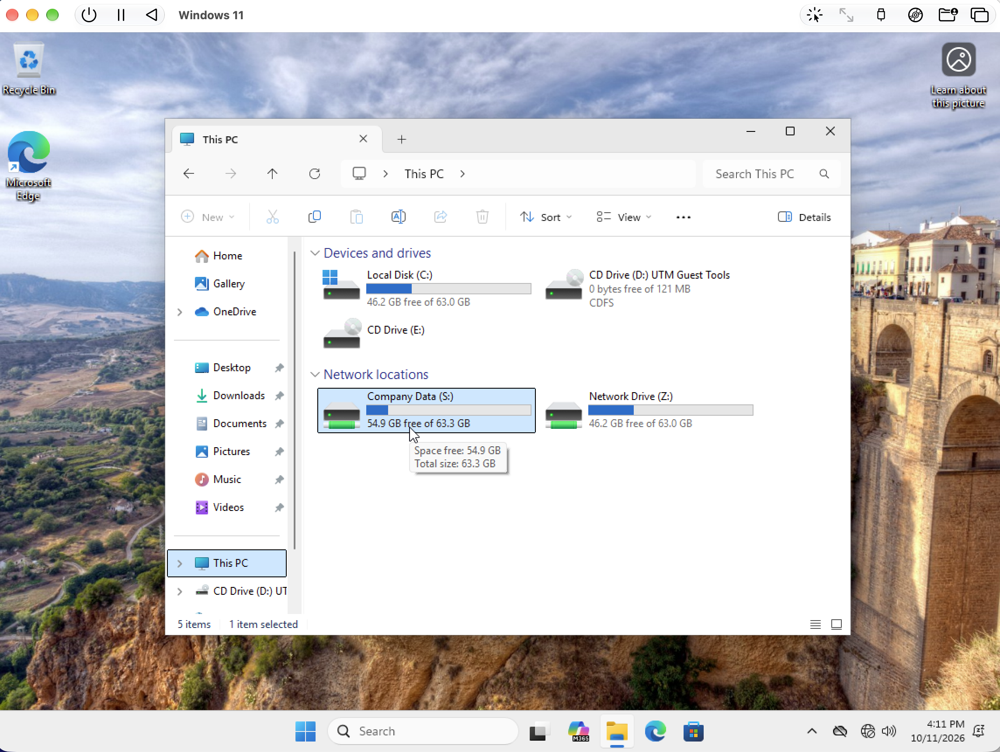
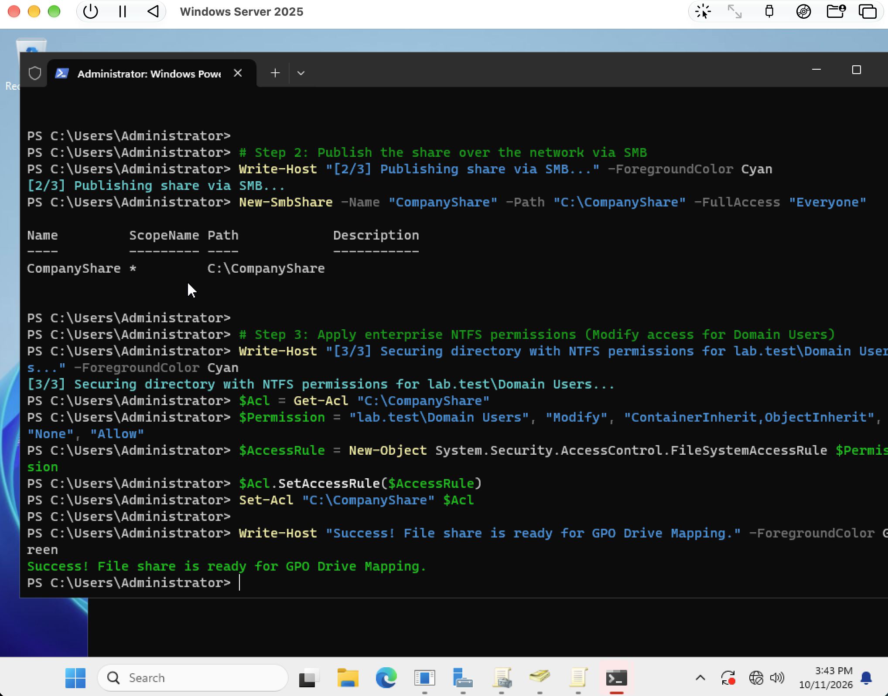
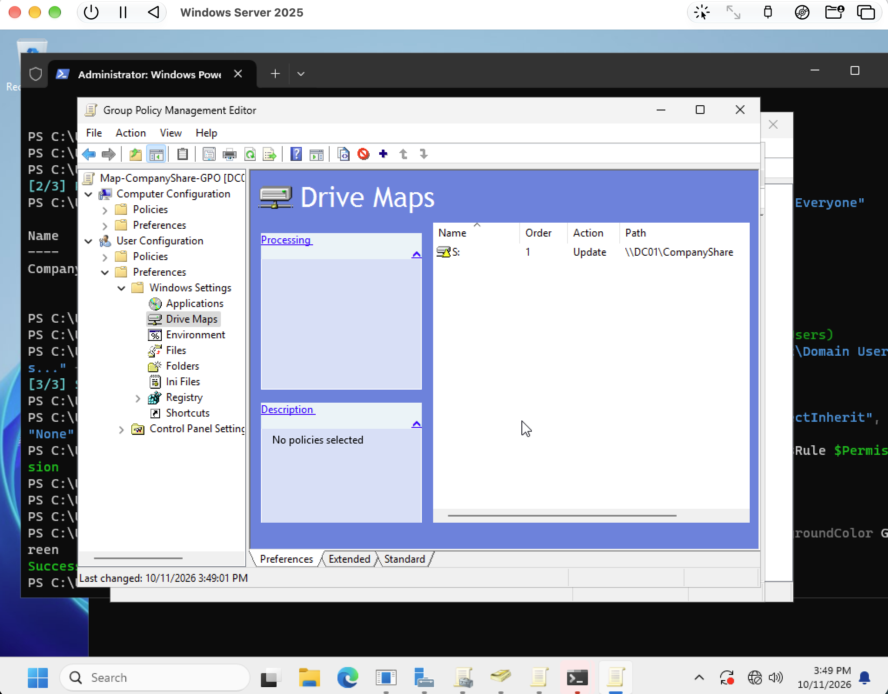
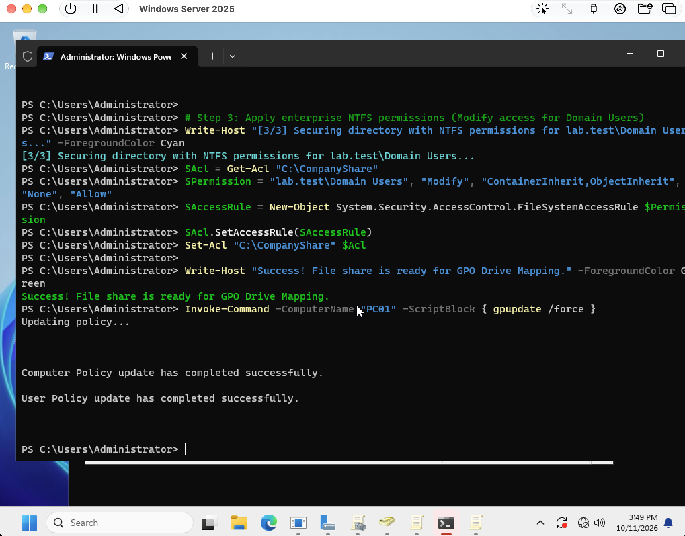
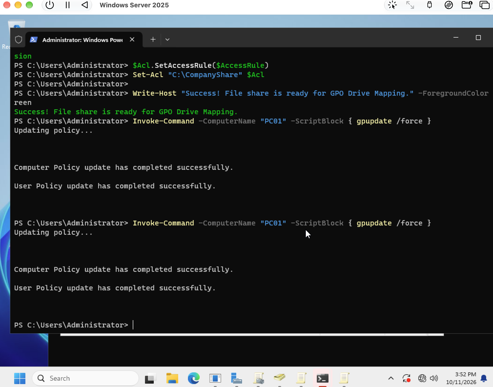
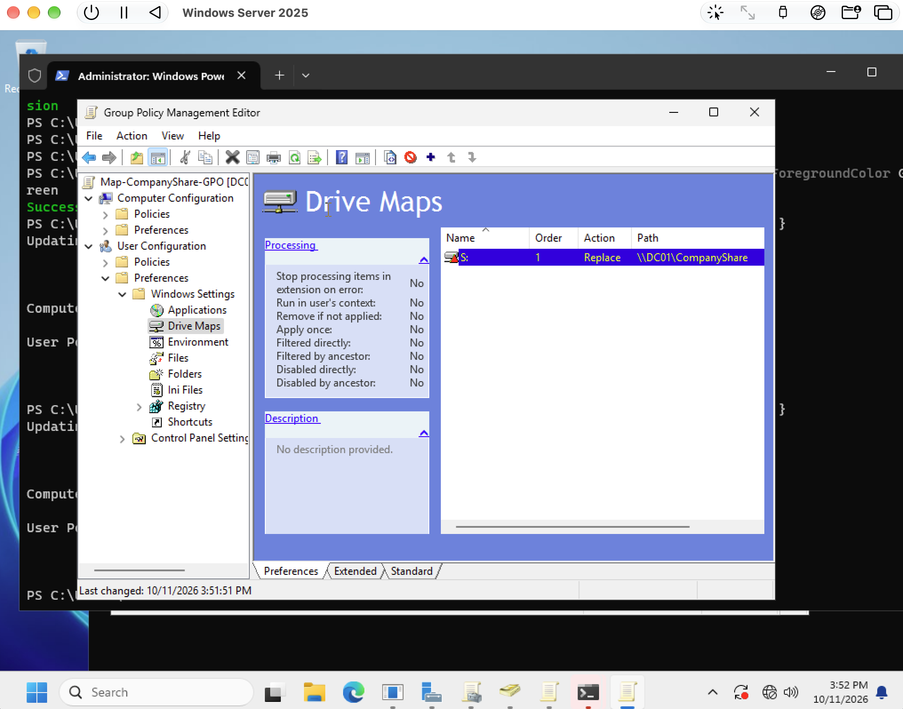

# File sharing and drive mapping

[Back to portfolio](../../README.md)

## Objective

Publish a shared folder and deliver a mapped drive to the workstation through Group Policy.

**Technologies:** SMB, NTFS permissions, Group Policy Preferences, PowerShell

## Implementation and results

The sequence shows creation of `CompanyShare` on DC01, commands assigning Domain Users Modify access through NTFS, and a Group Policy Preferences drive map to `\\DC01\CompanyShare`. The mapping changes from Update to Replace during troubleshooting. After policy refreshes, the client displays Company Data as drive S:.

**Outcome:** A mapped drive is visible on PC01. This is direct evidence of the client-facing result.

**Evidence limits:** The share command grants Everyone full share access. The effective access and group boundaries need positive and negative access tests with standard user accounts; those tests are not in the supplied screenshots. The console success message alone does not prove the final ACL. The additional Z: drive is visible but its purpose is not established.

## Result at a glance

## Evidence walkthrough

Screenshots are numbered chronologically within this module. Capture times come from original filenames; guest operating-system clocks may differ. Error screens are retained to show the troubleshooting sequence.

| Step | Evidence | Capture time |
| --- | --- | --- |
| 01 | [Create smb share and set ntfs permissions](screenshots/01-create-smb-share-and-set-ntfs-permissions.png) | 2026-10-11 at 15.43.38 |
| 02 | [Configure group policy drive map](screenshots/02-configure-group-policy-drive-map.png) | 2026-10-11 at 15.49.15 |
| 03 | [Refresh client policy remotely](screenshots/03-refresh-client-policy-remotely.png) | 2026-10-11 at 15.49.51 |
| 04 | [Repeat client policy refresh](screenshots/04-repeat-client-policy-refresh.png) | 2026-10-11 at 15.52.18 |
| 05 | [Change drive map action to replace](screenshots/05-change-drive-map-action-to-replace.png) | 2026-10-11 at 15.52.24 |
| 06 | [Verify mapped drive on pc01](screenshots/06-verify-mapped-drive-on-pc01.png) | 2026-10-11 at 16.11.50 |

Open the full screenshot walkthrough

### 01 Create smb share and set ntfs permissions

### 02 Configure group policy drive map

### 03 Refresh client policy remotely

### 04 Repeat client policy refresh

### 05 Change drive map action to replace

### 06 Verify mapped drive on pc01

