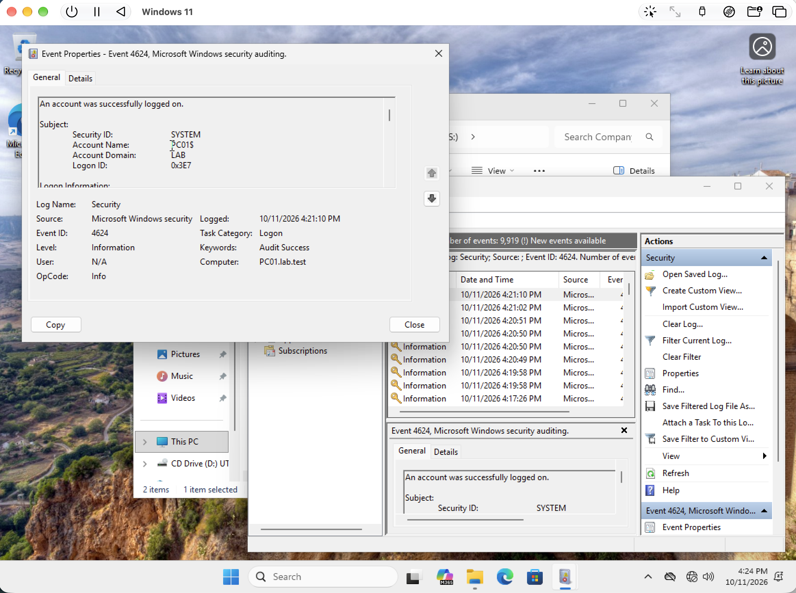

# Security event review

[Back to portfolio](../../README.md)

## Objective

Inspect a successful Windows logon event as an introduction to authentication auditing.

**Technologies:** Windows Event Viewer, Security log, Event ID 4624

## Implementation and results

The screenshot shows Event Viewer open to a successful logon event, Event ID 4624, on the Windows client.

**Outcome:** The record demonstrates inspection of a security event and its details.

**Evidence limits:** The progress report describes broader advanced audit-policy enforcement and filtering. This single screenshot does not verify domain-wide audit coverage, central collection, alerting, or a SIEM deployment. A useful next artifact would be the applied audit-policy output and an explained test-logon timeline.

## Result at a glance

## Evidence walkthrough

Screenshots are numbered chronologically within this module. Capture times come from original filenames; guest operating-system clocks may differ. Error screens are retained to show the troubleshooting sequence.

| Step | Evidence | Capture time |
| --- | --- | --- |
| 01 | [Inspect successful logon event 4624](screenshots/01-inspect-successful-logon-event-4624.png) | 2026-10-11 at 16.24.52 |

Open the full screenshot walkthrough

### 01 Inspect successful logon event 4624

