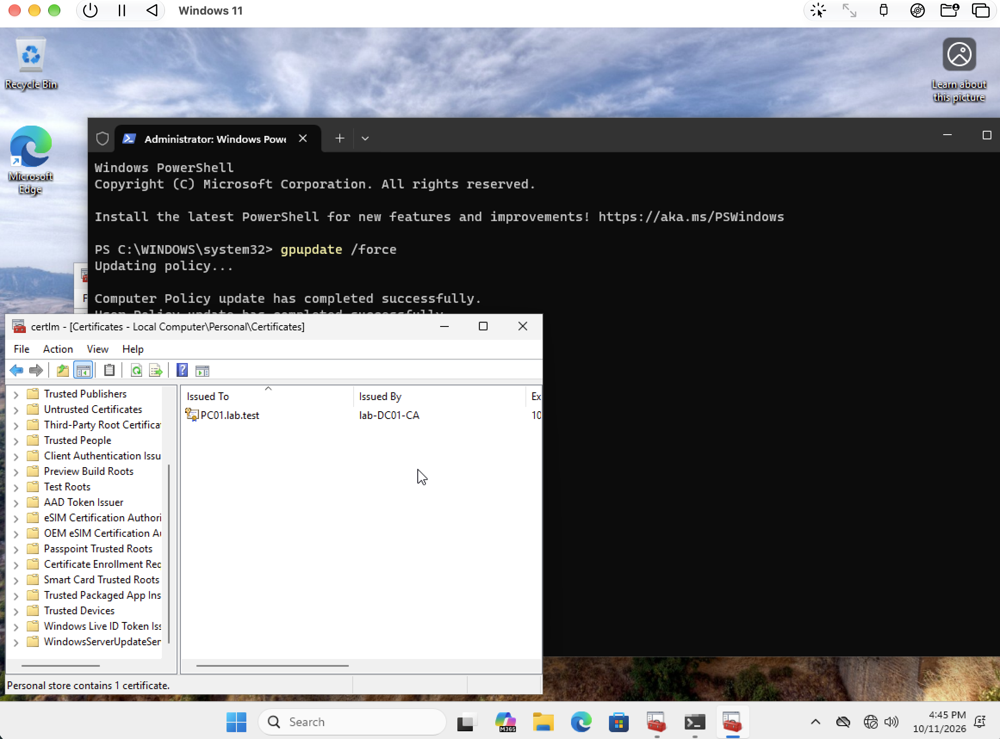
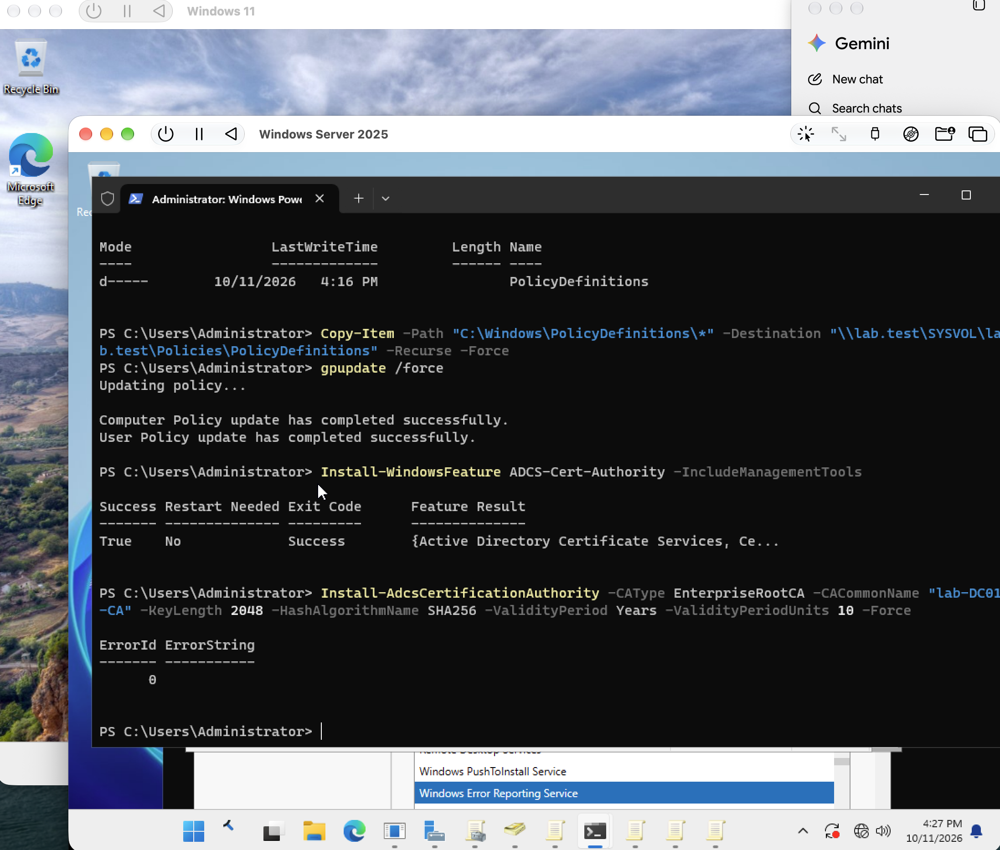
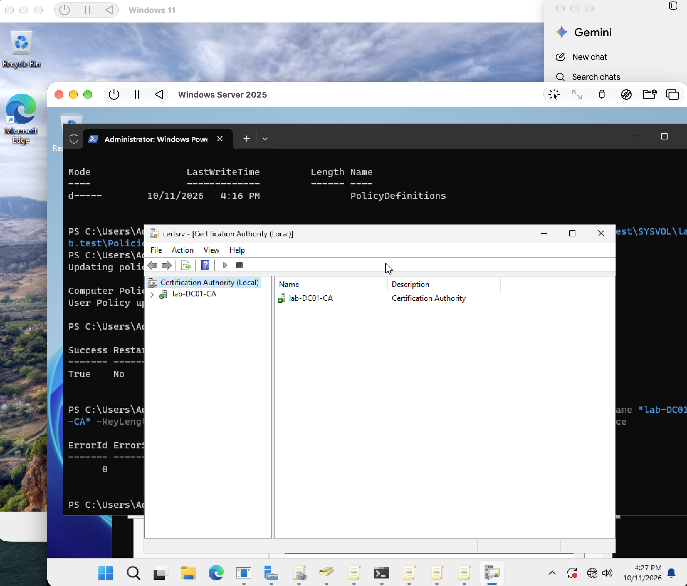
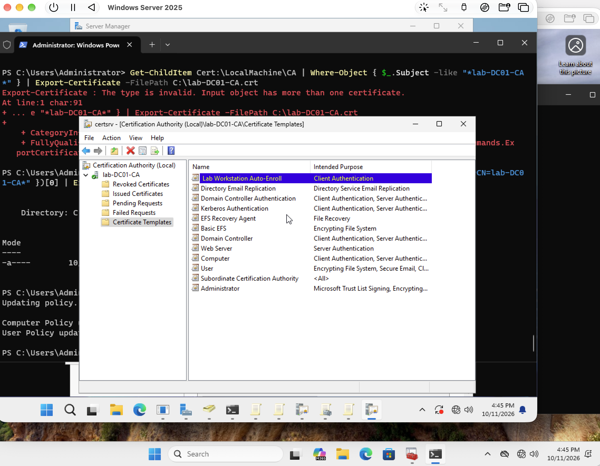

# Certificate services and workstation enrollment

[Back to portfolio](../../README.md)

## Objective

Establish a lab certificate authority and inspect a certificate issued to the workstation.

**Technologies:** AD CS, Group Policy, certificate templates, Windows certificate store

## Implementation and results

The record shows a PolicyDefinitions copy command, installation and initialization of AD CS, the `lab-DC01-CA` management console, and a published Lab Workstation Auto-Enroll template. The final client screenshot shows a certificate issued to `PC01.lab.test` by `lab-DC01-CA` in the local computer Personal store.

**Troubleshooting:** The template screenshot also contains a certificate-export error followed by an indexed export attempt. The workstation certificate is a visible outcome; the export error remains part of the troubleshooting record.

**Evidence limits:** The progress report describes root trust distribution and auto-enrollment settings. The screenshots do not independently show every template permission, GPO setting, trust-store entry, or renewal test. A certificate in the Personal store confirms issuance, but does not by itself establish the enrollment mechanism.

**Next work:** LDAPS testing and Windows LAPS are identified as next/planned work in the source report, not completed portfolio outcomes.

## Result at a glance

## Evidence walkthrough

Screenshots are numbered chronologically within this module. Capture times come from original filenames; guest operating-system clocks may differ. Error screens are retained to show the troubleshooting sequence.

| Step | Evidence | Capture time |
| --- | --- | --- |
| 01 | [Central store copy and ca installation](screenshots/01-central-store-copy-and-ca-installation.png) | 2026-10-11 at 16.27.14 |
| 02 | [Verify certificate authority console](screenshots/02-verify-certificate-authority-console.png) | 2026-10-11 at 16.27.49 |
| 03 | [Publish workstation template and troubleshoot export](screenshots/03-publish-workstation-template-and-troubleshoot-export.png) | 2026-10-11 at 16.45.02 |
| 04 | [Verify pc01 workstation certificate](screenshots/04-verify-pc01-workstation-certificate.png) | 2026-10-11 at 16.45.55 |

Open the full screenshot walkthrough

### 01 Central store copy and ca installation

### 02 Verify certificate authority console

### 03 Publish workstation template and troubleshoot export

### 04 Verify pc01 workstation certificate

